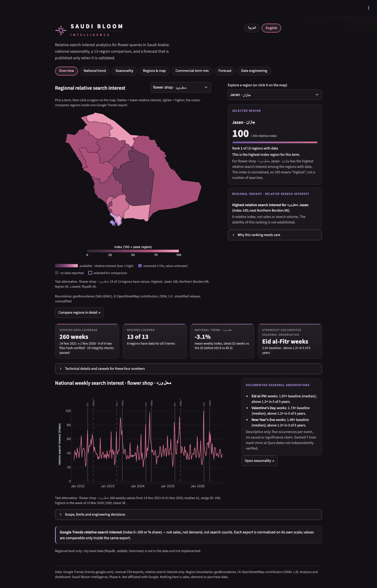
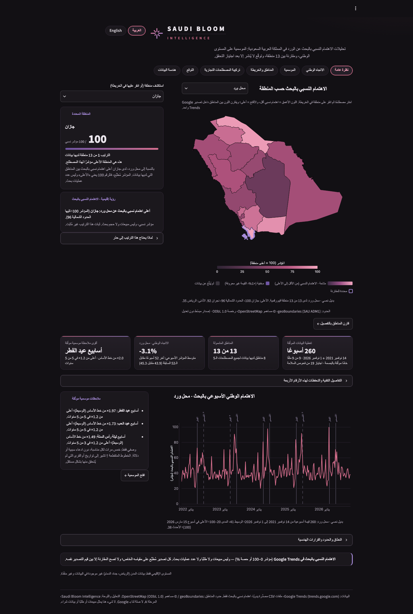
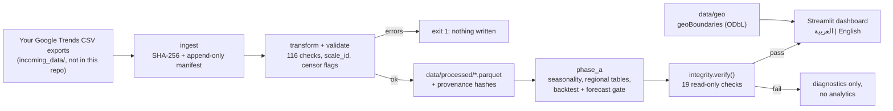
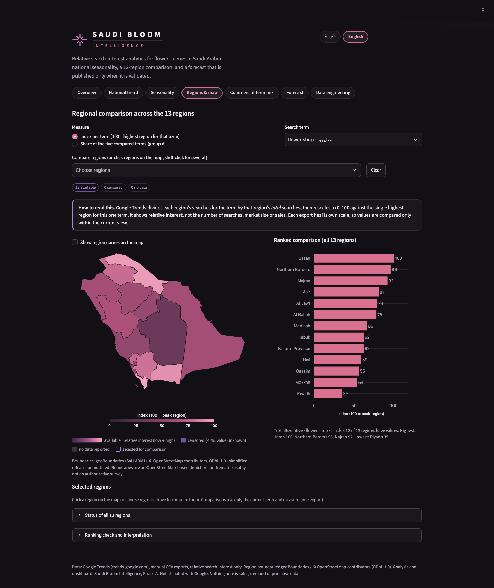
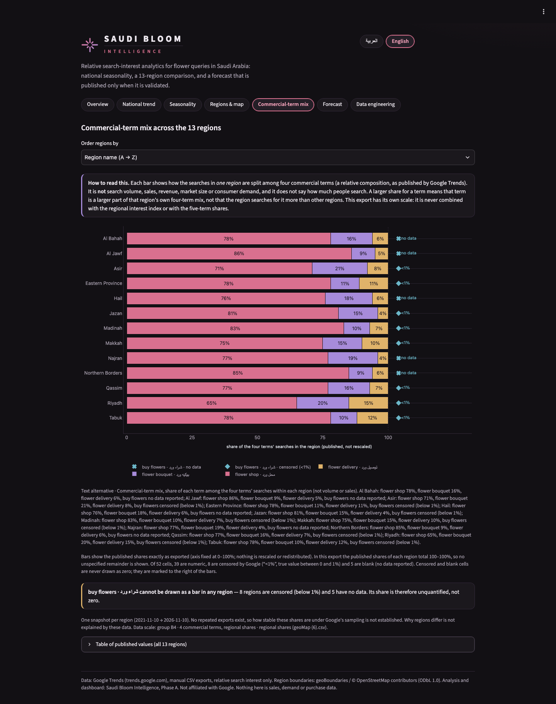

# SAUDI BLOOM INTELLIGENCE
*Discovering Saudi Arabia's Flower Search Trends*

**Status:** source code and documentation only. **No public dashboard is deployed**: the Google Trends data are not redistributed, so you run the dashboard locally on your own exports (see *Reproducibility*). · **Case study:** [CASE_STUDY.md](CASE_STUDY.md) · **Author:** Morooj Mohammed Alrajhi

**A bilingual (العربية | English), integrity-checked analytics dashboard for Google Trends *relative search interest* in flower-related Arabic queries across Saudi Arabia** — national seasonality, a 13-region interactive map, a commercial-term composition view, and a forecast that is **published only if it passes a rule fixed in advance (it did not, so it is withheld)**.

It is a data-engineering and applied-statistics project. It contains **no sales, revenue or demand data**, and it does **not** use LLMs, AI agents or deep learning: the analysis is classical statistics (STL decomposition, ridge regression, bootstrap) behind a validated pipeline.

| English | العربية |
|---|---|
|  |  |

> Screenshots are of the dashboard running locally on the author's own exports. Data source: Google Trends (https://www.google.com/trends); relative search interest, not sales or demand. Region boundaries: geoBoundaries / © OpenStreetMap contributors (ODbL 1.0). Not affiliated with Google.

## Why it exists
Google Trends exports are easy to misuse: every export is normalised on its own scale, low values are censored or blank, and nothing in them measures purchases. This project shows how to analyse them **honestly** — wrong comparisons (mixing scales, treating blanks as zero, implying sales) are made impossible or loudly rejected, and every claim is traceable to a hash-pinned raw file. The engineering story is in **[CASE_STUDY.md](CASE_STUDY.md)**.

## Core engineering capabilities
- **Provenance and integrity:** SHA-256-pinned raw files, an append-only manifest, per-output hashes, and a fail-closed `bloom.integrity` check (19 checks) that runs on every dashboard load. If anything is off, the dashboard shows **no analytics**.
- **Scale isolation:** every row carries `scale_id`; combining independently normalised exports raises `ScaleMixError`.
- **Honest missing data:** censored («<1%»), blank and reported-zero cells are three distinct states end to end; none is ever plotted or summed as zero.
- **Validated pipeline with exit codes** (0 ok · 1 validation errors, nothing written · 2 input/manifest failure).
- **Pre-registered forecast gate:** a calendar-feature model must beat the best naive baseline by ≥ 5% MAE *and* have a bootstrap 95% CI above zero. Result: +5.33%, CI [−0.89, 1.90] → **withheld**. Thresholds are pinned by tests and the integrity check.
- **Bilingual, accessible UI:** full Arabic (RTL) and English (LTR), a language switch that keeps your section/term/region, text alternatives for every chart, and map/chart states (numeric, censored, no data) also stated in text, tooltips and legends rather than by colour alone.
- **Geospatial:** 13-region choropleth from geoBoundaries (ODbL), hash-verified, ring-order fix at render time, click-to-select.
- **Quality gates:** 234 automated tests plus a real-browser check (Chrome, 1440/768/390 px, both languages).

## Architecture

Details: [DATA_METHODOLOGY.md](DATA_METHODOLOGY.md), [DATA_DICTIONARY.md](DATA_DICTIONARY.md), [CASE_STUDY.md](CASE_STUDY.md).

## What the dashboard shows
Overview (interactive map hero, four KPI cards) · National trend · Seasonality · Regions & map · Commercial-term mix · Forecast (why it is withheld) · Data engineering (integrity, provenance, scale per export).

| Regions & map | Commercial-term mix | Mobile (390 px, Arabic) |
|---|---|---|
|  |  |  |

## Technology stack
Python 3.13 (exact versions pinned in `requirements.txt` = `requirements.lock`) · pandas / pyarrow (Parquet) · statsmodels (STL) · numpy · Plotly · Streamlit · pytest · Chrome DevTools Protocol (browser checks). 46 pinned dependencies (`requirements.lock`); licence screening in [THIRD_PARTY_LICENSES.md](THIRD_PARTY_LICENSES.md).

## Validation and testing
| Check | Result |
|---|---|
| Automated tests, with data | **234 passed** (`pytest`) |
| Automated tests, fresh clone **without** data | 68 passed, 166 skipped with an explicit reason, 0 failed |
| Runtime integrity | 19 / 19 (`python -m bloom.integrity`) |
| Pipeline validation | 116 checks, 0 errors, 6 documented warnings |
| Browser checks (`scripts/browser_check.py`) | all pass at 1440 / 768 / 390 px in English and Arabic: layout, direction, language switch, map clicks, tooltips |
| Fresh environment from `requirements.lock` | installed set matches the 46 pins exactly |

Data-dependent tests (they need your exports) skip with the message *"supply your own Google Trends exports, then run bloom.pipeline and bloom.phase_a"*; they are never weakened to pass an empty install. Details: [TEST_RESULTS.md](TEST_RESULTS.md).

## Reproducibility
```bash
git clone <repo> && cd saudi-bloom-intelligence
python3 -m venv .venv && .venv/bin/python -m pip install -r requirements.lock      # Python 3.13
export PYTHONPATH=src
.venv/bin/python -m pytest -q          # data-independent tests run; data-dependent ones skip with a reason
.venv/bin/streamlit run app/streamlit_app.py     # shows a clear "no data" message until you add exports  (?lang=ar for Arabic)
```

### Bring your own data
The Google Trends exports are **not included** (their redistribution terms are not cleared — see below). To rebuild everything:
1. In trends.google.com choose **Saudi Arabia**, **Past 5 years**, **All categories**, **Web Search**. Export all nine CSVs **on the same day** (the validator checks that regional and weekly windows agree):
   - *Interest over time*, 5 terms `ورد, توصيل ورد, بوكيه ورد, محل ورد, شراء ورد` → 1 file; the same chart with the 4 commercial terms `توصيل ورد, بوكيه ورد, محل ورد, شراء ورد` → 1 file.
   - *Interest by subregion* for the same 5-term comparison → 1 file; for the 4-term comparison → 1 file; and for **each single term** → 5 files.
2. Put the nine `.csv` files in `incoming_data/` (file names do not matter; the pipeline identifies each export by its content).
3. `python -m bloom.pipeline && python -m bloom.phase_a && python -m bloom.integrity` — a missing or wrong export is named in plain language; nothing is written on failure.
4. `streamlit run app/streamlit_app.py`.

Results should match the case study if you export the same period; Google Trends is sampled and re-normalised on every export, so small differences are expected (and are exactly why stability is called "not established").

## Data-use restrictions
- **Google Trends data** is *not licensed by this project and not in this repository*; it is subject to the Google Terms of Service. Google's help page allows using Trends information with attribution ("Data source: Google Trends"); it does not explicitly address republishing exported CSV files, so they are excluded by `.gitignore` (`incoming_data/`, `data/raw/`, `data/processed/`, manifests). Assessment with sources: [DATA_USE_ASSESSMENT.md](DATA_USE_ASSESSMENT.md).
- **Boundaries** (`data/geo/`): geoBoundaries gbOpen, © OpenStreetMap contributors, **ODbL 1.0**; attribution in the app and `data/geo/ATTRIBUTION.md`. Thematic use only (area ≈ 10% below common figures: `data/geo/AREA_DISCREPANCY.md`).
- **Code:** MIT (original code only), © 2026 Morooj Mohammed Alrajhi — see `LICENSE`. Dependencies: [THIRD_PARTY_LICENSES.md](THIRD_PARTY_LICENSES.md).
- Not affiliated with Google.

## Limitations
Relative interest only (never sales or demand) · about five annual cycles, so seasonal findings are descriptive · regional values are one snapshot per region (no regional time series or forecasts) · rank stability and Trends sampling noise are not measured · **no city-level analysis**: a city export lacked Riyadh, Jeddah and Dammam and held within-city shares only (summary in `CASE_STUDY.md`, section 9) · not tested: Safari/Firefox, real devices, screen readers, keyboard-only use.

## Future development
More annual cycles and repeated exports (then re-run the same gate unchanged) · regional weekly series (Phase B, **not started**) · a city pilot only if a shared-scale export for the three cities can be obtained · accessibility testing with assistive technology.

## Repository layout
```
src/bloom/    ingest transform validate calendar_features analysis forecast phase_a overview integrity geo schema report
app/          streamlit_app, components, i18n (ar/en), theme, bidi, assets/
tests/        234 tests (data-independent and data-dependent)       scripts/   browser_check.py, export_check.py, audit_licenses.py
data/geo/     boundary data + attribution (the only data shipped)    docs/images/  screenshots used in this README
```
Documents: [CASE_STUDY.md](CASE_STUDY.md) · [DATA_METHODOLOGY.md](DATA_METHODOLOGY.md) (what is cleaned vs validated) · [DATA_DICTIONARY.md](DATA_DICTIONARY.md) · [DATA_SOURCES.md](DATA_SOURCES.md) · [DATA_VALIDATION_REPORT.md](DATA_VALIDATION_REPORT.md) · [DATA_USE_ASSESSMENT.md](DATA_USE_ASSESSMENT.md) · [TEST_RESULTS.md](TEST_RESULTS.md) · [REGIONAL_RANKING_VERIFICATION.md](REGIONAL_RANKING_VERIFICATION.md) · [CITY_LEVEL_FEASIBILITY.md](CITY_LEVEL_FEASIBILITY.md) · [THIRD_PARTY_LICENSES.md](THIRD_PARTY_LICENSES.md)
